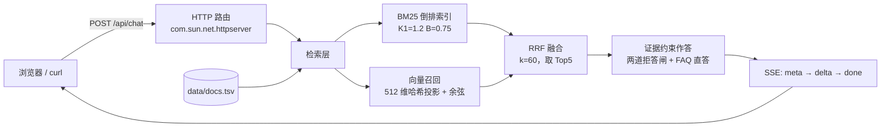

# enterprise-rag · 企业知识库 RAG 问答系统（可运行演示版）

> 上传文档 → 解析切片 → 混合检索（BM25 + 向量）→ RRF 融合 → 证据约束作答 → 答案带 `[n]` 引用，证据不足直接拒答。
> **零第三方依赖**：只需要 JDK 17，`javac` + `java` 两条命令就能跑起来，不需要 Docker、不需要 API Key。

这个仓库有两层内容：

| 层 | 是什么 | 在哪 |
| --- | --- | --- |
| **演示版（可运行）** | 用 JDK 自带 `com.sun.net.httpserver` 从零实现检索、融合、拒答、SSE 流式，前端是单文件页面 | `demo/` |
| **生产版设计（文档）** | 七个容器的完整栈：Spring Boot 3 + Spring AI + PostgreSQL/pgvector + Elasticsearch/IK + MinIO + Ollama + Vue3 | `docs/architecture.md` 等 |

这样做的原因很直接：**能力应该跑给人看**。生产栈要 Docker、要模型权重、要七套服务，任何人都能照着文档写出来，但不是任何人都能让一个 RAG 系统在本机 30 秒内起来、并且当场演示"该拒答的时候真的拒答"。所以演示版把关键链路自己实现了一遍，参数与生产版严格对齐，方便逐环节对照。

---

## 一、能做什么

- **知识库管理**：上传 / 列出文档，切片入库，重启后从 `data/docs.tsv` 恢复
- **混合检索**：BM25 关键词召回 + 向量语义召回，两路并行，RRF 融合排序
- **证据约束作答**：只用检索到的片段组句，每句带 `[n]` 引用，可点开看来源
- **拒答**：证据强度不足时不生成答案，明确告知"证据不足"并给出原因——这一条是 RAG 与"套壳聊天"的分界线
- **SSE 流式输出**：`meta`（先给证据卡片）→ `delta`（正文逐段）→ `done`
- **推荐问题**：页面内置 4 个问题，一键演示；`?demo=1` 自动提问，方便录屏截图

## 二、架构



生产栈的同一张图（七个容器、端口、数据流、逐环节对照）见 [`docs/architecture.md`](docs/architecture.md)。

## 三、快速开始

```bash
# 需要 JDK 17+，无其他依赖
git clone https://github.com/<你的用户名>/enterprise-rag-demo.git
cd enterprise-rag-demo/demo
mkdir out
javac -encoding UTF-8 -d out src/com/tanke/rag/*.java
java -cp out com.tanke.rag.Main 8765
```

打开 <http://127.0.0.1:8765/> ，左栏就是知识库（首次启动自动灌入 6 篇示例文档），右栏直接提问.

Windows 双击 `tools/run.bat` 等价于上面三步。

跑一遍冒烟（7 段：健康 / 统计 / 文档 / 检索 / 问答 / 拒答 / SSE）：

```bash
python demo/smoke.py          # 结果写到 demo/smoke_result.txt
```

## 四、界面

单文件前端（`demo/ui/index.html`，无构建、无 CDN）：左栏知识库统计 + 新增文档 + 文档列表，右栏对话，答案下方是 `[n]` 引用卡片，拒答时是橙色提示框而不是假装有答案。

截图请在自己机器上跑 `tools/run.bat` 起服务后，双击 `tools/shot.bat`（headless Edge 抓一张 `docs/img/ui.png`）——**仓库里不放"看起来像截图"的图**，能自己跑出来的才叫证据。

## 五、接口

| 方法 | 路径 | 说明 |
| --- | --- | --- |
| GET | `/api/health` | 健康检查，返回 uptime 与版本 |
| GET | `/api/stats` | 文档数 / 切片数 / 词表大小 / 平均切片长度 / 检索器与向量方案 |
| GET | `/api/docs` | 文档列表 |
| POST | `/api/docs` | 新增文档（form：`title`、`content`） |
| POST | `/api/search` | 只跑召回与融合，不生成——用于调参和验证召回质量 |
| POST | `/api/ask` | 非流式答案 + 引用 + `refused`，适合脚本批跑 |
| POST | `/api/chat` | SSE 流式作答 |

字段级契约（JSON 示例、SSE 帧、错误码）见 [`docs/api.md`](docs/api.md)。

## 六、三个值得展开的设计点

### 1. 双路召回 + RRF，而不是"只上向量"

关键词路用 BM25（`K1=1.2`、`B=0.75`），向量路用 512 维带符号哈希投影 + 余弦。两路各取 Top20，用 RRF 融合：

```
fused(d) = Σ_i 1 / (k + rank_i(d))     k = 60
```

两路都排第 1 的切片约 `2/61 ≈ 0.0328`，只在单路排第 2 约 `1/62 ≈ 0.0161`——"两路共识"天然排在"单路偏好"前面，不需要归一化两套完全不同量纲的分数（这是 RRF 相比加权求和最实用的地方）。

`/api/search` 会同时回 `bm25Rank`、`vecRank`、`fused`、`coverage`，一眼就能看出某条证据是共识还是单路召回。

### 2. 拒答：两道闸，判据是绝对 BM25 分数

| 闸 | 条件 | 拒答原因 |
| --- | --- | --- |
| 1 | 问题里的词在知识库中一个都没出现过 | `证据不足：提问中的词在知识库中均未出现` |
| 2 | Top1 片段 BM25 `< 1.8` | `证据不足：Top1 证据强度 0.546 < 1.800` |

**走过一次弯路，值得写下来**：最初用"问题词的 IDF 加权覆盖率 < 0.34"作判据，实测区分不出来——"切片大小和重叠是多少"（该作答）cov=0.082，而"这个系统的开发者是谁"（该拒答）cov=0.074，只差 0.008。根因是提问里那些知识库中根本不存在的二元组被赋予了最大 IDF，把分母撑爆，on-topic 的问题也被压到 0.1 以下。

改成 Top1 的绝对 BM25 分数后就干净了。阈值 1.8 不是拍的，是用 `demo/probe_scores.py` 在 12 个标注问题上逐条量出来的（打分表见 `demo/probe_scores.txt`），并提成具名常量 `MIN_BM25`——换语料必须重标定，所以它不该散在判定语句里当字面量。

### 3. 证据约束作答 + FAQ 直答

- 默认从 Top5 片段里挑句子，按"句子对问题的 IDF 加权重合度 / √句长"打分，最多 3 条引用、5 个引用位
- 知识库里的 `问：…答：…` 结构会被识别成 FAQ：若用户提问与某个"问"的相似度 `≥ 0.25`，就只复用那一组答案、**按原文顺序整组输出**（而不是按打分逐句挑，导致步骤 3 跑到步骤 1 前面）
- 兜底：候选句池为空 → 拒答 `证据不足：片段与提问无有效重合`

## 七、实测数据（本机，可复现）

### 冒烟矩阵 6/6 通过（`demo/smoke_result.txt`）

| 提问 | Top1 文档 | 是否作答 | 判定 |
| --- | --- | --- | --- |
| 检索链路是怎么设计的？ | FAQ · 检索链路与部署 | ✔ | OK |
| 一共有哪七个容器，各自负责什么？ | FAQ · 检索链路与部署 | ✔ | OK |
| 部署时最容易踩的坑是什么？ | FAQ · 检索链路与部署 | ✔ | OK |
| 切片大小和重叠是多少？ | FAQ · 检索链路与部署 | ✔ | OK |
| 如何训练一个多模态大模型？ | 技术栈与架构 | ✘ 拒答 | OK |
| 今天北京的天气怎么样？ | FAQ · 检索链路与部署 | ✘ 拒答 | OK |

索引规模：6 篇文档 / 8 个切片 / 词表 660 / 平均切片 145 字。SSE：`meta`=1、`delta`=19、`done`=1，首字节 2.4ms，全程 303ms。

### 压测（`loadtest/loadtest.py`，python 多线程客户端，含客户端开销）

| 接口 | 并发 | RPS | P50 | P95 | P99 | 错误 |
| --- | --- | --- | --- | --- | --- | --- |
| `/api/search` | 16 | 3827.1 | 3.4ms | 5.8ms | 6.6ms | 0 |
| `/api/ask` | 8 | 4138.3 | 1.8ms | 2.5ms | 2.9ms | 0 |

> 读这组数字要戴上两副眼镜：①这是**演示版**，检索在进程内、作答是抽取式拼接，没有网络、没有模型推理；②生产版延迟由 Elasticsearch/pgvector 的 RTT 和大模型首 token 时间主导，量级完全不同。**所以这组数据只说明"我的服务端代码在并发下不塌"，不能用来论证生产性能。** 完整四档并发在 `loadtest/loadtest_result.txt`。

## 八、目录结构

```
enterprise-rag/
├── demo/
│   ├── src/com/tanke/rag/       # Json / Text / Index / Answer / Store / Main，共 6 个类，零第三方依赖
│   ├── ui/index.html            # 单文件前端（知识库管理 + 对话 + 引用卡片 + 拒答提示）
│   ├── smoke.py                 # 7 段冒烟，写 smoke_result.txt
│   ├── probe_scores.py          # 标定拒答阈值用的打分探针
│   └── data/docs.tsv            # 持久化（首次启动自动生成）
├── docs/                        # 生产栈设计：architecture / api / deploy / production
├── loadtest/                    # 压测脚本与结果
└── tools/                       # Windows 一键启动、截图
```

## 九、演示版 ↔ 生产版的差距（不藏）

| 环节 | 演示版 | 生产版 |
| --- | --- | --- |
| 向量 | 512 维哈希投影（近似语义，**不能**用来论证模型效果） | `bge-m3` / text-embedding，pgvector + HNSW |
| 关键词 | 进程内 BM25 倒排 | Elasticsearch + IK 分词 |
| 生成 | 抽取式拼接证据句子，不调模型 | Ollama `qwen2.5:7b` 流式生成，证据约束 Prompt |
| 存储 | 内存索引 + 单文件 tsv | PostgreSQL + Elasticsearch + MinIO + Redis |
| 鉴权 / 限流 / 多租户 | 无 | Sa-Token + 网关限流 + 租户隔离 |
| 部署 | 一条 `java -cp out` | Docker Compose 编排七个服务 |

演示版 `/api/stats` 里 `embedding` 字段自报为 `hash-projection-512d`，`retriever` 自报 `bm25+vector+rrf(k=60)`——**诚实标注是刻意设计**，避免被误读成用了真实 embedding 模型。

## 十、路线图

- [ ] 接入真实 embedding（`bge-m3`）替换哈希投影，保留同一套 `/api/*` 契约
- [ ] `docker compose` 一键起生产栈，与 `docs/deploy.md` 的 16 项验证清单对齐
- [ ] 增加离线评测集：召回率 / 引用准确率 / 拒答精确率三个指标
- [ ] 用 k6 重做压测，分出服务端与客户端开销
- [ ] 多轮会话与追问改写（生产栈设计里已有，演示版未实现）

## 十一、发布到自己的 GitHub

仓库自带一键推送脚本（会校验 token、自动创建远程仓库、推送并记住凭证）：

```powershell
powershell -NoProfile -ExecutionPolicy Bypass -File tools\push.ps1
```

或 Windows 下直接双击 `tools\push.bat`。需要一个 Personal Access Token（classic 勾 `repo`，或 fine-grained 勾 `Contents: Read and write`）。token 只在这个进程内存里，不写进 `.git/config`；成功后存入 Windows 凭据管理器，清除用 `cmdkey /delete:git:https://github.com`。

## 十二、许可

MIT。示例语料是虚构的项目自述，不含任何真实业务数据.

---

**这个仓库想说明的一件事**：RAG 的难点不在"调用模型"，而在检索质量、融合策略、以及"什么时候该老实说不知道"。前两项能调参，最后一项只能靠想清楚判据——上面第六节的弯路就是代价。
