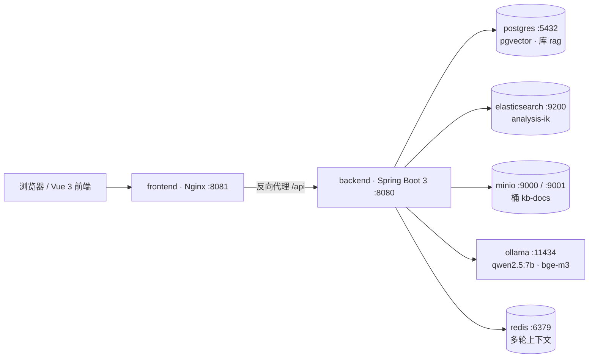
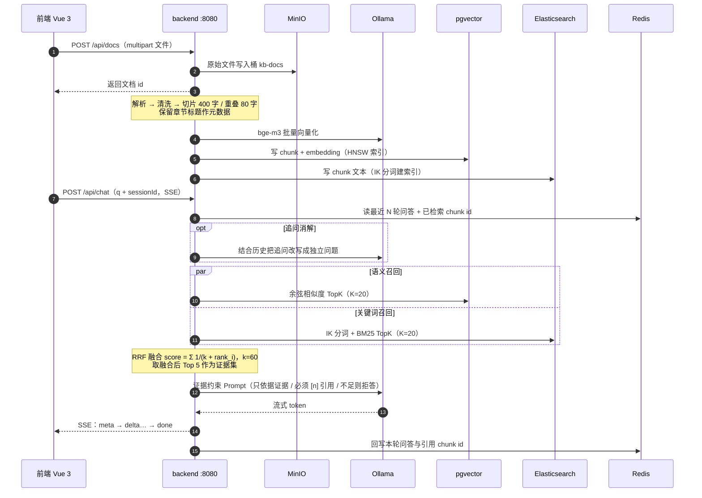

# 企业知识库 RAG 问答系统 · 架构设计

## ▎1. 定位与范围

本项目是**企业知识库 RAG 问答系统**的复现 + 二次开发工程（仓库代号 `enterprise-rag`）。目标不是做一个"能聊天的 Demo"，而是把一条可上线的检索增强问答链路完整落地：文档进入、可检索、有证据、有引用、能拒答、能多轮追问，并且接口层具备权限、限流、超时与去重能力。

文档描述两个形态及其关系：

| 形态 | 位置 | 技术形态 | 用途 |
| --- | --- | --- | --- |
| 生产栈 | 仓库根目录 + `docker-compose` | Java 21 / Spring Boot 3 / Spring AI / MyBatis-Plus + PostgreSQL 16 + pgvector + Elasticsearch 8 + MinIO + Ollama + Redis + Vue 3 / Nginx | 真实部署形态，功能完整 |
| 演示版 | 仓库内 `demo/` | JDK 17 原生 `HttpServer`：512 维哈希向量 + BM25 倒排 + RRF + SSE + 抽取式作答 + 拒答闸门，监听 `8765` | 零依赖直接跑通，用于本地演示与压测 |

两者**接口路径一致**（见 `api.md`），因此同一套 curl 脚本与冒烟测试可以在两种形态上对跑。但要分清等价的范围：检索、RRF 融合、引用编号、SSE 时序、拒答判定这几步是对齐的；**生成环节不等价**——演示版从证据片段里抽句子拼答案，不调用模型，所以它验证不了 Prompt 遵循度与幻觉率。

## ▎2. 生产栈组成与端口

| 服务 | 镜像/角色 | 端口 | 关键配置 |
| --- | --- | --- | --- |
| `postgres` | PostgreSQL 16 + `pgvector` 扩展 | 5432 | 库名 `rag`，用户 `rag` / 密码 `rag` |
| `elasticsearch` | Elasticsearch 8，单节点 | 9200 | 已装 `analysis-ik` 中文分词插件 |
| `minio` | 对象存储 | 9000（S3 API）/ 9001（控制台） | 桶名 `kb-docs` |
| `ollama` | 本地模型推理 | 11434 | 预拉 `qwen2.5:7b`（生成）与 `bge-m3`（向量） |
| `redis` | 会话上下文与热点缓存 | 6379 | 存最近 N 轮问答 + 检索过的 chunk id |
| `backend` | Spring Boot 3 应用 | 8080 | Spring AI 接入 Ollama，MyBatis-Plus 访问 PG |
| `frontend` | Nginx 托管 Vue 构建产物 | 8081 | 静态资源 + `/api` 反向代理到 `backend:8080` |

技术栈清单（版本以 `pom.xml` / `package.json` 为准）：Java 21、Spring Boot 3、Spring AI、MyBatis-Plus、PostgreSQL 16 + pgvector、Elasticsearch 8 + IK、MinIO、Ollama（qwen2.5 系列）、Redis、Vue 3 + Vite、Nginx、Docker Compose。

### 部署拓扑



前端不直接访问中间件，所有读写都经过 `backend`；`frontend` 只做静态托管与 `/api` 反代，这样权限、限流、审计都收敛在一个入口。

## ▎3. 检索链路：6 个环节

整个链路可以拆成"入库"与"问答"两段，共 6 步。



### ASCII 兜底图

```
┌──────────┐   /api    ┌──────────────────────────────────────────────┐
│ 浏览器    │──────────▶│  Nginx :8081  →  backend :8080               │
│ Vue 3    │◀──────────│                                              │
└──────────┘   SSE     │  ① 上传   ② 解析切片   ③ 双路召回            │
                       │  ④ RRF 融合  ⑤ 证据约束问答  ⑥ SSE 输出      │
                       └───┬────────┬────────┬────────┬────────┬───────┘
                           │        │        │        │        │
                    ┌──────▼──┐ ┌───▼────┐ ┌─▼──────┐ ┌▼─────┐ ┌▼──────┐
                    │ MinIO   │ │ pgvec  │ │ ES 8   │ │Ollama│ │ Redis │
                    │ kb-docs │ │ :5432  │ │ :9200  │ │:11434│ │ :6379 │
                    └─────────┘ └────────┘ └────────┘ └──────┘ └───────┘
                       原始文件   语义 TopK  BM25 TopK  bge-m3  上下文
```

### 2.1 上传

支持 `pdf / docx / md / txt`，文件落 MinIO 桶 `kb-docs`，返回文档 id。原始文件保留是为了可追溯与可重建索引：切片策略或 embedding 模型变更时，不必让用户重新上传。

### 2.2 解析与切片

抽取纯文本 → 清洗（去页眉页脚、多余空白、控制字符）→ **固定字数切片，窗口 400 字，重叠 80 字**，同时把所在**章节标题**作为元数据存到每个 chunk 上。

三个取值都有明确理由：

- **固定字数而非固定 token**：切分不依赖模型 tokenizer，索引侧与检索侧口径统一，切完的片段长度可预期。
- **重叠 80 字（窗口的 20%）**：保证跨切片边界的句子至少完整出现在一个片段里，避免"答案被切断在两句之间"这种典型召回失败。
- **章节标题入元数据**：标题本身就是高密度关键词（"第三章 报销标准"），既能在 ES 侧参与召回，也能在 Prompt 里给模型提供上下文层级，避免模型把片段错归到别的章节。

### 2.3 双路召回

| 路径 | 存储 | 打分 | K | 擅长 |
| --- | --- | --- | --- | --- |
| 语义路 | pgvector | 余弦相似度 | 20 | 同义改写、口语化提问、跨表述匹配 |
| 关键词路 | Elasticsearch + IK | BM25 | 20 | 专有名词、编号、型号、人名、精确术语 |

两条路互补而非冗余：语义路对"报销要多久到账"能召回"费用报销时限"；关键词路对"GB/T 19001"这种语义模型几乎无法表达的字面串更可靠。任一路单独使用都会在某一类问题上明显掉召回，这是选择混合检索的根本原因。

### 2.4 RRF 融合

两路分数量纲不同（余弦相似度落在 [-1, 1]，BM25 无上界），直接加权求和需要标定，且会随语料漂移。RRF 只用**排名**，天然免疫量纲问题：

```
score(d) = Σ_i 1 / (k + rank_i(d))     k = 60
```

其中 `rank_i(d)` 是文档 d 在第 i 路结果里的名次（从 1 开始），未被某一路召回的文档该路不贡献。`k=60` 的作用是**压平头部差距**：`1/(60+1)=0.0164` 与 `1/(60+2)=0.0161` 只差 2%，避免某一路的第 1 名靠单路优势直接霸榜；同时"两路都排得靠前"的文档因为累加两项而稳定胜出。融合后取 **Top 5** 作为证据集。

Top 5 是证据量与上下文成本之间的折中：再多会把无关片段塞进 Prompt、稀释指令遵循度；再少则容易在跨切片问题上证据不全。

### 2.5 证据约束问答

证据集按 `[1]…[5]` 编号拼进 Prompt，并施加三条硬约束：

1. **只依据证据回答**——不允许用模型自身的世界知识补充；
2. **必须给出 `[n]` 引用**——每个结论后标注来源编号，编号与证据集一一对应；
3. **证据不足时明确拒答**——宁可回答"现有知识库中没有找到依据"，也不许编造。

第 3 条是这套系统能被企业接受的前提：一个会说"不知道"的系统，其输出的可信度才可被评估。拒答逻辑同时保护了引用机制——若模型被允许自由作答，`[n]` 引用就会退化成装饰。

### 2.6 SSE 输出

流式响应按固定时序推进，前端可以据此做渐进渲染：

```
meta   → 证据列表（先给用户看到"依据哪些文档"）
delta  → 逐 token 正文
done   → 引用明细 + 耗时
```

先推 `meta` 是刻意设计：前端在正文开始前就能渲染出证据卡片，用户对答案的信任建立在"看到来源"之上，而不是等到全文结束。协议细节与示例帧见 `api.md`。

## ▎4. 核心数据模型

### 4.1 chunk 元数据（逻辑字段）

| 字段 | 说明 |
| --- | --- |
| `chunk_id` | 切片唯一标识，ES 与 PG 共用同一取值，作为融合时的对齐主键 |
| `doc_id` | 所属文档 id |
| `chunk_seq` | 文档内顺序号，用于回拼上下文与"取相邻切片" |
| `section_title` | 章节标题，来自解析阶段 |
| `content` | 400 字窗口文本 |
| `embedding` | `bge-m3` 输出向量，列类型为 pgvector `vector` |

`chunk_id` 两侧同源是 RRF 能落地的前提：融合发生在应用层，若不共享主键，就得靠文本哈希对齐，一旦清洗规则微调就会对不上。

### 4.2 索引

- **pgvector**：表结构与索引由 **Flyway** 管理，使用 **HNSW** 索引、余弦距离。迁移脚本纳入版本控制，保证多环境（本地 / 测试 / 生产）索引定义一致，避免"手工建索引漏了"导致退化成全表扫描。
- **Elasticsearch**：chunk 文本以 IK 分词建索引，BM25 打分。

### 4.3 会话

Redis 保存**最近 N 轮问答**与**检索过的 chunk id**。前者用于理解"它""这个流程"之类的指代，后者用于在追问时优先复用已命中的证据（避免同一话题反复全库检索，也保证多轮之间引用口径稳定）。

## ▎5. 横切工程点

| 关注点 | 做法 | 解决的问题 |
| --- | --- | --- |
| 表结构与索引 | Flyway 版本化迁移 | 环境间 schema 漂移、索引缺失 |
| 模型接入 | 模型连接与**场景路由**统一配置（向量场景 / 生成场景分开配置） | 换模型、换地址不散落在业务代码里 |
| 权限 | 接口层**双层权限**：系统角色 + 组内角色 | 同一份知识库在不同部门可见范围不同 |
| 稳定性 | 限流 / 超时 / 取消 | 慢模型拖垮线程池、用户关页面后计算继续空转 |
| 成本 | 多实例下同一答题请求 **single-flight 去重** | 并发重复提问只调一次模型 |

**single-flight** 值得单独说明：RAG 的一次问答要调一次生成模型，7B 级模型单次推理是秒级占用。多实例部署下，同一个用户重复点击、或前端重连，会产生若干"问题文本 + 证据集完全相同"的请求。若不去重，N 个并发就等于 N 次推理；去重后只有一个请求真正打模型，其余订阅同一份流式结果。这与 Redis 缓存不同——缓存解决"隔一段时间再问"，single-flight 解决"同一瞬间一起问"。

**取消**同样不只是体验问题：SSE 连接断开后若继续推理，算力与显存都被浪费，还会挤占其他请求。因此在流式回调里检查连接状态，断开即中止。

## ▎6. 演示版（`demo/`）与生产栈的对应关系

演示版用 JDK 17 原生 `HttpServer` 实现同一条链路的精简版，目标是**零依赖直接跑通**：

| 环节 | 生产栈 | 演示版 `demo/` |
| --- | --- | --- |
| 向量检索 | pgvector + HNSW 余弦 TopK | 进程内向量数组，余弦暴力扫描 TopK |
| 关键词检索 | Elasticsearch + IK + BM25 | 进程内 BM25 倒排索引 |
| 融合 | RRF，k=60，取 Top 5 | 同公式同参数 |
| 生成 | Ollama `qwen2.5:7b` 流式生成 | 无模型调用：抽取式拼接证据句子（最多 3 片段 / 5 引用） |
| 输出 | SSE `meta → delta → done` | 同协议（每帧 8 字、间隔 15ms 模拟流式） |
| 拒答 | 证据不足则由 Prompt 约束 + 后置校验 | 两道硬闸：问题词全部落在库外 / Top1 片段 BM25 < 1.8 |
| 存储 | MinIO + PG + ES + Redis | 内存索引 + `data/docs.tsv` 行文本持久化 |
| 接口 | `/api/*` | 与生产版**路径一致** |

接口清单：`GET /`（Web 演示页）、`GET /api/health`、`GET /api/stats`、`POST /api/docs`（form：`title`、`content`）、`GET /api/docs`、`POST /api/search`（只跑召回与 RRF，供检索调参）、`POST /api/ask`（非流式答案，供脚本与评测批跑）、`POST /api/chat`（form：`q`，返回 SSE）。演示版默认监听 `8765`，生产 `backend` 为 `8080`，因此两者可以同时在本机运行、互不冲突。

演示版的语义向量是 **512 维带符号哈希投影**（token → `hashCode % 512` → 单位化），不是 `bge-m3`。它在 `/api/stats` 里如实自报为 `hash-projection-512d`：这是近似语义打分，能跑通链路与排序逻辑，但**不能**用来论证模型效果——对外说明时必须区分开，否则等于用哈希去冒充 embedding。

演示版的价值有两个：一是评审者无需 Docker 即可看到完整链路行为；二是压测时可以先用它验证并发模型与 SSE 行为，把"算法问题"和"中间件问题"分开定位。

## ▎7. 设计取舍与已知边界

**为什么混合检索而不是单一向量库。** 企业文档里编号、制度条款编号、产品型号大量存在，纯向量检索在这类字面精确匹配上不稳定；而纯 BM25 又扛不住口语化提问。双路 + RRF 是在不引入 rerank 模型（额外一次推理开销）的前提下，性价比最高的组合。

**为什么不上 rerank。** 交叉编码器 rerank 通常能再提一档精度，但要多一次模型推理，且 7B 生成模型已经占满本地算力。当前先用 RRF 融合 + Top 5，把成本压在可接受范围；若后续替换为更强的生成模型或多卡环境，再考虑加 rerank。这是一个明确的、可被推翻的决策，而不是遗漏。

**为什么固定字数切片。** 语义切片（按段落/标题）质量更好，但实现与调参成本高，且不同文档格式差异大。400/80 的字数切片在四类格式上行为稳定，是"先能跑、可复现"的选择。

**已知边界：**

- PDF 中的表格、扫描件（纯图片）目前不在解析覆盖范围内，表格会被压平成文本流，行列关系丢失；
- 图片、附件不进入检索；
- 拒答依赖模型对指令的遵循度，7B 模型偶有"证据不足仍作答"的越界，需要靠 Prompt 与后置校验双重约束；
- 固定字数切片在超长条款、代码块场景下可能切断结构。

**待实测项（本仓库尚未填入真实数据，不做推测）：**

> 待运行填入：单文档（例如一份 100 页 PDF）从上传到可检索的端到端耗时，以及切片数量。
>
> 待运行填入：Top 5 证据集在自建评测集上的命中率 / 引用正确率（需先固定评测集与判定标准）。
>
> 待运行填入：并发 N 路问答下的首 token 延迟、完整回答 P95 延迟，以及 single-flight 生效前后的模型调用次数对比。
>
> 待运行填入：语义单路、关键词单路、RRF 融合三者的召回率对比，用于验证混合检索的实际收益。
